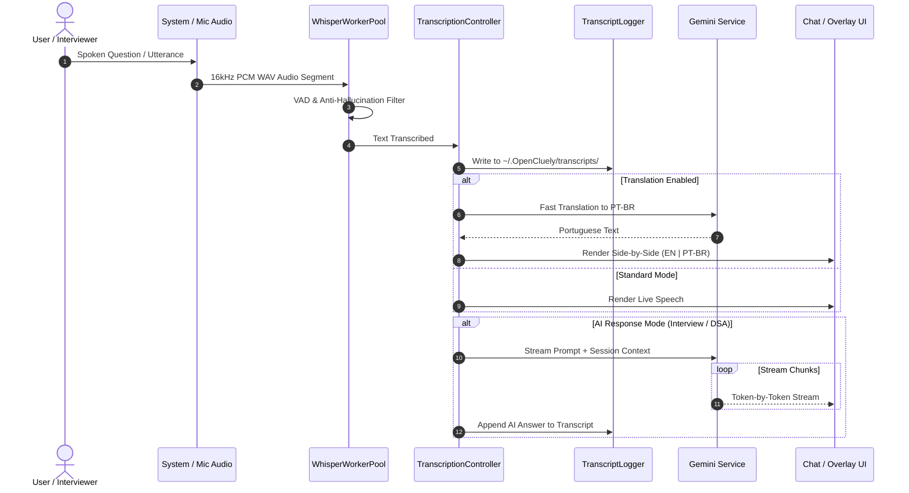

<div align="center">

# OpenCluely

**The invisible, real-time AI interview copilot & intelligent meeting companion.**

Real-time multi-modal AI reasoning, dual-source audio transcription, real-time bilingual translation, and automated call logging — delivered through a stealth screen overlay that conference tools cannot capture.

<p>
  <a href="https://github.com/TechyCSR/OpenCluely/releases/latest"></a>
  <a href="LICENSE"></a>
  
  
  
</p>

<a href="#-key-features">Key Features</a> &nbsp;|&nbsp;
<a href="#-system-architecture">Architecture</a> &nbsp;|&nbsp;
<a href="#-audio--transcription-pipeline">Audio Pipeline</a> &nbsp;|&nbsp;
<a href="#-quick-start">Quick Start</a> &nbsp;|&nbsp;
<a href="#-shortcuts">Shortcuts</a> &nbsp;|&nbsp;
<a href="#-configuration-reference">Configuration</a> &nbsp;|&nbsp;
<a href="#-project-structure">Project Structure</a>

</div>

---

## 🌟 Key Features

### 1. 🛡️ Invisible Stealth Overlay & Anti-Detection
- **OS-Level Screen-Share Exclusion**: Leverages OS window flags (`NSWindowSharingNone` on macOS, `WDA_EXCLUDEFROMCAPTURE` on Windows via `setContentProtection(true)`). The overlay is 100% invisible to Zoom, Google Meet, Microsoft Teams, Discord, Slack, and OBS.
- **Process Camouflage & Title Disguise**: Configurable window titles and masquerading processes (e.g. `Calculator`, `Notes`, `System Activity`).
- **Click-Through Transparency (`Alt + A`)**: Instantly toggle between full mouse/keyboard interaction and transparent click-through so you can code or navigate during calls without moving the overlay.
- **Auto-Hide on Screen Share**: Automatically minimizes or hides windows when screen sharing is detected.

---

### 2. 🎙️ Dual-Audio & Whisper Worker Pool
- **Dual-Source Audio Capture**: Captures both microphone input and system audio loopback (interviewer speech from conference apps).
- **Parallel Whisper Worker Pool**: Multi-process worker pool (`WhisperWorkerPool`) that handles speech segments concurrently to eliminate transcription backpressure.
- **Voice Activity Detection (VAD) & Anti-Hallucination**: High-precision energy gating that suppresses background noise and discards silence hallucinations.
- **Dual Backend**: Offline local Whisper with optional CUDA GPU acceleration or cloud-based Azure Cognitive Services.

---

### 3. 🌐 Real-Time Side-by-Side Bilingual Translation (PT-BR)
- **Live Translation Column**: Instantly translates spoken English (or any language) to Brazilian Portuguese.
- **Dual-Column UI**: Displays spoken original transcript on the left and Portuguese translation on the right.
- **Fast Toggle**: One-click `[PT: ON / OFF]` button in the chat toolbar with persistent preference.

---

### 4. 🎙️ Identificação de Locutores por Canal (Speaker Diarization: Você vs. Entrevistador)
- **Separação Nativa por Hardware/Canal**: Identifica com precisão a origem de cada trecho de fala sem depender de modelos de diarização lentos na nuvem:
  - 🎤 **Áudio do Microfone** $\rightarrow$ etiquetado em tempo real como `[VOCÊ]` (badge verde).
  - 💻 **Áudio do Sistema / Loopback** $\rightarrow$ etiquetado em tempo real como `[ENTREVISTADOR]` (badge ciano).
- **Segmentação Inteligente de Turnos**: Quando o interlocutor começa a falar enquanto o outro está ativo, o buffer de áudio é descarregado instantaneamente, separando perguntas e respostas de forma 100% fiel à dinâmica da conversa.
- **Rastreabilidade Completa**: Tanto a janela de Chat quanto os arquivos de transcrição salvos registram a autoria exata de cada intervenção.

---

### 5. 📚 Gerenciador Visual de Reuniões Passadas & Resumos com IA
- **Histórico & Busca Textual no App**: Modal integrado no topo do Chat (`[Histórico]`) com listagem completa de reuniões gravadas em `~/.OpenCluely/transcripts/`:
  - 🔍 **Busca em Tempo Real**: Filtre instantaneamente por participante, tópico, palavra-chave, data ou modalidade.
  - 🗂️ **Cards com Metadados Ricos**: Exibe duração (`⏱️`), contagem de falas e palavras (`📝`), badges dos locutores detectados (`VOCÊ`, `ENTREVISTADOR`) e status de resumo (`✨ Resumo Pronto` vs `📝 Transcrição`).
  - 📖 **Painel de Pré-Visualização em 2 Abas**:
    - **Resumo da Reunião**: Visualização executiva em Markdown rica com síntese dos tópicos, decisões e ações.
    - **Transcrição Completa**: Visualização em formato de script de diálogo com badges coloridos para cada locutor.
  - ⚡ **Ações Rápidas em 1 Clique**:
    - `Copiar`: Copia resumo ou transcrição para a área de transferência.
    - `Resumir com IA`: Gera ou regera a ata executiva sob demanda via Gemini.
    - `Abrir Arquivo`: Abre o arquivo bruto `.txt` no editor padrão do SO.
    - `Excluir`: Remove tanto o arquivo de transcrição quanto seu resumo associado com confirmação.
- **Executive Meeting Summary (Resumo da Reunião)**:
  - 🎯 **Visão Geral**: Contexto e objetivos essenciais da sessão.
  - 💬 **Tópicos Principais**: Pontos de discussão estruturados em tópicos claros.
  - ✅ **Decisões & Acordos**: Alinhamentos e decisões tomadas.
  - 🚀 **Próximos Passos & Ações**: Lista de tarefas, responsáveis e prazos.
  - 💡 **Destaques & Perguntas Relevantes**: Perguntas técnicas e respostas-chave.
- **Gatilhos Múltiplos**: Botão `[Resumo]` no topo do chat, banner interativo pós-chamada (`Reunião finalizada. [Resumir Reunião]`), atalho `/resumo` / `/summary`, ou direto pelo Gerenciador de Histórico.

---

### 6. 🚀 Sugestões Preditivas de Resposta em Tempo Real (Smart Talking Points)
- **Zero Hesitação nas Respostas**: Enquanto o entrevistador formula uma pergunta, a IA detecta a intenção e gera **3 marcadores estratégicos de resposta rápida** em menos de 500ms na tela invisível (stealth overlay) e no chat.
- **Estrutura Triangular de Alto Impacto**:
  - `1. [Abordagem Direta]`: Posicionamento conceitual imediato para iniciar a fala nos primeiros 3 segundos.
  - `2. [Exemplo Concreto / Arquitetura]`: Caso de uso prático, métricas e stack real do candidato.
  - `3. [Trade-off / Diferencial]`: Ponto sênior de atenção, consistência vs escalabilidade e armadilhas evitadas.
- **Pipeline Duplo Simultâneo**: Os 3 talking points aparecem no banner com destaque antes mesmo da resposta técnica completa terminar de ser transmitida token a token via streaming.

---

### 7. 📤 Exportador com 1-Clique (PDF Executivo, Notion, Slack & Checklist)
- **Exportação Nativa em PDF**: Gera relatórios executivos diagramados em PDF vetorial via engine Chromium do Electron, prontos para impressão ou compartilhamento, com métricas, resumo, checklist e diálogo diarizado.
- **Template para Notion / Slack**: Converte toda a ata em formato Markdown limpo e estilizado, pronto para colar diretamente em canais do Slack, Notion docs, Linear ou Obsidian.
- **Checklist Interativa de Próximos Passos**: Extrai automaticamente compromissos e tarefas combinadas na reunião com sintaxe de checkboxes `- [ ]` com cópia em 1-clique.
- **Comandos Rápidos no Chat**: Acesse instantaneamente via botões no modal ou comandos `/pdf`, `/notion`, `/checklist`, `/pontos <pergunta>`.

---

### 8. 👁️ Eye-Line Teleprompter & Modo Olhar Periférico (Notch View - `Alt + T`)
- **Zero Movimento Ocular / Eye-Contact Preservado**: Janela ultra-compacta translúcida que se fixa automaticamente logo abaixo da lente da webcam/notch do monitor (`Snap to Camera 🧲`).
- **Tópicos Dinâmicos de 7 a 10 Palavras (Bite-sized Bullets)**: Em vez de parágrafos extensos que forçam a leitura mecânica, exibe apenas os ganchos essenciais com palavras-chave de arquitetura realçadas em destaque.
- **Auto-Pace com Transição Suave**: Avanço automático configurável (3s, 5s ou 8s por tópico) com barra de progresso visual sutil no rodapé, permitindo responder sem encostar no teclado.
- **Navegação em 1 Toque**: Navegue com `←` e `→` / `Espaço`, alterne Auto-Pace com `P`, fixe no notch com `N` e alterne visibilidade com `Alt + T`.

---

### 9. ⚡ Multi-LLM Failover & Fallback Local (Zero Downtime)
- **Zero Downtime Circuit Breaker**: Se a API do Google Gemini sofrer instabilidade, erro de quota 429, timeout (>3.5s) ou oscilação de conexão no meio da entrevista, a requisição transita sem interrupção para provedores alternativos.
- **Alternância Flexível Pago vs. Gratuito**:
  - ⚡ **Modo Auto Failover (Padrão)**: Prioriza Google Gemini (rápido e preciso); se o circuito abrir (429 / indisponibilidade), chaveia instantaneamente para o OpenRouter (modelos gratuitos `:free`) e para o Ollama local.
  - 🆓 **Modo OpenRouter Free**: Opera sem qualquer custo utilizando LLMs de ponta gratuitas via OpenRouter (`deepseek/deepseek-r1:free`, `meta-llama/llama-3.3-70b-instruct:free`, `qwen/qwen-2.5-coder-32b-instruct:free`, `google/gemini-2.0-flash-exp:free`).
  - 💎 **Modo Gemini Exclusivo**: Opera focado exclusivamente nos modelos Gemini da Google AI Studio.
  - 🏠 **Modo Ollama Local (100% Offline)**: Execução local via Ollama (`http://localhost:11434`) para quando a conexão com a internet cair completamente.
- **Streaming Token-a-Token Preservado**: Todas as rotas de failover mantêm o protocolo SSE / Streaming delta em tempo real.
- **Painel de Configurações com Testes Instantâneos**: Teste a latência e a saúde de cada provedor (Gemini, OpenRouter, Ollama) com badges de status visuais nas Configurações.

---

### 10. 🚨 Boss Key & Modo Pânico Instantâneo (`Alt + Q` / `Cmd/Ctrl + Shift + X` / `/panic`)
- **Camuflagem Total em 1 Milissegundo**: Pressionar `Alt + Q` (ou `Cmd/Ctrl + Shift + X`) oculta 100% das janelas ativas da aplicação imediatamente sem deixar rastros ou animações que chamem a atenção.
- **Pausa Protetora de Microfone**: Pausa instantaneamente qualquer gravação de voz ativa para evitar capturar áudio indevido durante interrupções físicas (ex: alguém entrando na sala ou compartilhamento inesperado).
- **Ocultação de Dock & Restauração Fiel**: Oculta o ícone do Dock no macOS e, ao pressionar novamente, restaura com precisão apenas as janelas que estavam visíveis antes do pânico.

---

### 11. 🛡️ Modo Zero-Touch (Detecção Proativa de Perguntas & Gatilho Automático)
- **Operação 100% Sem as Mãos**: Elimina a necessidade de tocar no teclado ou no mouse durante momentos de alta tensão na entrevista.
- **Detecção Semântica Interrogativa**: Analisa em tempo real a fala do entrevistador no canal do sistema (`[ENTREVISTADOR]`). Quando identifica construções interrogativas em Português ou Inglês (ex: *"Como você faria..."*, *"Qual foi seu maior desafio..."*, *"Could you explain how..."*), aciona a geração proativa da resposta automaticamente.
- **Alerta Visual Suave**: Banner sutil no topo do chat notifica que a pergunta foi capturada e que os Smart Talking Points e resposta completa já estão sendo calculados.
- **Ativação Rápida**: Alterne com 1 clique no botão `[Zero-Touch: ON/OFF]` da barra do chat ou pelo comando `/zerotouch`.

---

### 12. 🎯 Central de Conhecimento Dinâmica do Candidato (RAG & Histórico de Projetos / Método STAR)
- **Respostas Baseadas na Sua Realidade Profissional**: Em vez de respostas genéricas de IA que soam artificiais, o OpenCluely recupera automaticamente seus cases reais de carreira para fundamentar cada resposta.
- **Estrutura no Padrão STAR**:
  - **S (Situação)**: Desafio de negócio, volume de tráfego, legado ou incidente crítico.
  - **T (Tarefa)**: Sua meta técnica e responsabilidade específica.
  - **A (Ação)**: Arquitetura implementada, padrões de projeto (DDD, Cache-Aside, Circuit Breaker) e decisões práticas.
  - **R (Resultado)**: Métricas quantificáveis de alto impacto (latência -90%, R$ 2M economizados, 99.99% SLA).
- **Busca Semântica & BM25**: A cada pergunta da entrevista, o sistema busca na sua base local (`~/.OpenCluely/candidate-knowledge.json`) os cases mais relevantes e os injeta diretamente no prompt do LLM.
- **Gerenciador Visual & CRUD**: Modal dedicado no Chat (`[STAR]` ou `/star`) com cards coloridos e formulário para cadastrar, editar e remover seus projetos profissionais.

---

### 13. 💻 Live Code Sentinel & Corner Case Watcher (LeetCode / CoderPad / `Alt + C` / `/sentinel`)
- **Blindagem Contra Armadilhas em Live Coding**: Detecta armadilhas ocultas que costumam reprovar candidatos em entrevistas técnicas (LeetCode, HackerRank, CoderPad).
- **Atalho Global Instantâneo (`Alt + C`)**: Pressione `Alt + C` ou digite `/sentinel` para analisar instantaneamente o código selecionado na tela ou a última pergunta transcrita.
- **Relatório Estruturado de Armadilhas**:
  - ⚠️ **Inputs Vazios & Limites**: Vetores vazios `[]`, strings vazias `""`, $N = 0$ ou $1$.
  - ⚠️ **Overflow & Tipagem**: Estouro de inteiro de 32-bits ($> 2^{31}-1$), divisões por zero, acumulação em 64-bits.
  - ⚠️ **Estruturas Cíclicas & Off-by-One**: Ciclos em grafos/listas ligadas, ponteiros nulos, matrizes não quadradas.
  - ⚠️ **Trava de Complexidade (TLE)**: Alerta se $O(N^2)$ estourará o tempo limite para $N \ge 10^5$, indicando o alvo ótimo $O(N \log N)$ ou $O(N)$.
  - 🛡️ **Validações Defensivas Recomendadas**: Snippet de código pronto para colar com as validações de guarda que impressionam entrevistadores seniores.

---

### 14. 🧠 Multimodal AI Reasoning (Google Gemini)
- **Direct Visual Screen Reasoning (`Cmd/Ctrl + Shift + S`)**: Takes screen/region captures and streams them directly into Gemini for instant problem solving without lossy OCR steps.
- **Low-Latency Streaming**: Token-by-token streaming response rendered in real-time.
- **Rich Code & Math Rendering**: Full syntax highlighting via PrismJS and mathematical formula rendering (LaTeX/MathJax).

---

### 15. 🎯 Specialized Skills & Dynamic Prompts
- **Interview Skill**: Structured guidance, follow-up answers, behavioral tips, and system design insights.
- **DSA Skill**: Optimal algorithms, $O(n)$ time/space complexity analysis, and implementation in C++, Python, Java, JavaScript, or C.
- **Sales & Pitch Skill**: Objection handling, value propositions, and live negotiation assistance.
- **Transcript Skill**: Pure dictation and bilingual translation without invoking AI answer generation.
- **Hot-Reloadable Prompts**: Edit prompt files on the fly without restarting the app.

---

## 🏛️ System Architecture

OpenCluely follows a modular Electron architecture designed for high throughput, memory safety, and complete process isolation.

```mermaid
flowchart TB
    subgraph UI_Layer [Frontend Windows (Renderer Process)]
        Overlay[Floating Stealth Overlay<br/><code>overlay.html</code>]
        Chat[Chat & Bilingual Interface<br/><code>chat.html</code>]
        Settings[Settings Window<br/><code>settings.html</code>]
    end

    subgraph Security_Bridge [IPC & Preload Bridge]
        Preload[Context Isolated Preload<br/><code>preload.js</code>]
    end

    subgraph Core_Controllers [Main Process Controllers]
        Main[Main Coordinator<br/><code>main.js</code>]
        TranscriptionCtrl[Transcription Controller<br/><code>src/controllers/transcription.controller.js</code>]
        CaptureCtrl[Capture Controller<br/><code>src/controllers/capture.controller.js</code>]
        ShortcutCtrl[Shortcut Controller<br/><code>src/controllers/shortcut.controller.js</code>]
    end

    subgraph Audio_Engine [Audio & Speech Pipeline]
        Microphone[Microphone Stream]
        Loopback[System Loopback Audio<br/><code>system-audio.service.js</code>]
        WhisperPool[Whisper Worker Pool<br/><code>whisper-worker.service.js</code>]
        AzureSpeech[Azure Speech Service<br/><code>azure-speech.service.js</code>]
    end

    subgraph AI_Engine [AI & Services Layer]
        LLM[LLM Service & Gemini API<br/><code>src/services/llm.service.js</code>]
        SessionMgr[Session Memory & Disk Store<br/><code>src/managers/session.manager.js</code>]
        TranscriptLogger[Transcript File Logger<br/><code>src/services/transcript-logger.service.js</code>]
        PromptLoader[Prompt Loader & Hot-Reload<br/><code>prompt-loader.js</code>]
    end

    UI_Layer <-->|IPC Channels via ContextBridge| Security_Bridge
    Security_Bridge <--> Core_Controllers
    Microphone & Loopback --> WhisperPool & AzureSpeech
    WhisperPool & AzureSpeech --> TranscriptionCtrl
    TranscriptionCtrl --> TranscriptLogger
    TranscriptionCtrl --> LLM
    CaptureCtrl --> LLM
    LLM <--> SessionMgr
    LLM --> Core_Controllers
    PromptLoader --> LLM
    Core_Controllers --> UI_Layer
```

---

## 🌊 Audio & Transcription Pipeline



---

## ⌨️ Global Shortcuts

| Action | Shortcut | Function |
|---|---|---|
| **Boss Key / Modo Pânico** | `Alt + Q` / `Cmd/Ctrl + Shift + X` | Oculta 100% das janelas imediatamente, pausa gravação e esconde o dock |
| **Live Code Sentinel** | `Alt + C` | Analisa armadilhas de código, edge cases (LeetCode/CoderPad) e complexidade |
| **Eye-Line Teleprompter (Notch)** | `Alt + T` / `Cmd/Ctrl + Alt + T` | Alterna o teleprompter compacto alinhado com a webcam/notch |
| **Screenshot Analysis** | `Cmd/Ctrl + Shift + S` | Captura área da tela e envia diretamente para raciocínio com IA |
| **Toggle Speech Recognition** | `Alt + R` | Inicia / Pausa captura e transcrição de áudio |
| **Toggle Click-Through Mode** | `Cmd/Ctrl + Shift + I` or `Alt + A` | Alterna modo clique-transparente (stealth) vs interativo |
| **Toggle Window Visibility** | `Cmd/Ctrl + Shift + V` | Alterna visibilidade geral de janelas |
| **Open Chat Interface** | `Cmd/Ctrl + Shift + C` | Abre a janela principal de chat e transcrição bilíngue |
| **Settings Panel** | `Cmd/Ctrl + ,` | Abre o painel de configurações (Multi-LLM, Áudio, Atalhos) |

### 💬 Comandos Rápidos no Chat (Slash Commands)
- `/panic` ou `/boss` — Ativa o Boss Key (Modo Pânico Instantâneo).
- `/zerotouch` — Ativa/desativa a detecção proativa de perguntas sem mãos.
- `/star` ou `/rag` — Abre a Central de Conhecimento com seus cases reais no método STAR.
- `/sentinel [código]` — Executa análise de casos de borda e armadilhas para o código fornecido ou recente.
- `/notch` ou `/prompter` — Alterna o teleprompter ou envia tópicos manuais (`/notch <tópico>`).
- `/pontos <pergunta>` — Gera 3 Smart Talking Points estratégicos para responder na hora.
- `/resumo` — Gera ata executiva e resumo com IA da reunião atual.
- `/pdf` — Exporta relatório executivo diagramado em PDF vetorial.
- `/checklist` — Extrai os Action Items da conversa formatados em checklist.
- `/notion` ou `/slack` — Copia ata formatada para colar em canais ou documentações.
- `/historico` — Abre o histórico de reuniões passadas salvas.

---

## 🚀 Quick Start

### 1. Prerequisites
- **Node.js**: v18.0.0 or higher
- **Python**: 3.9+ (optional, required if using local Whisper)
- **ffmpeg & sox**: (optional, required for local microphone capture)

### 2. Clone and Setup
```bash
# Clone the repository
git clone https://github.com/TechyCSR/OpenCluely.git
cd OpenCluely

# Run the automated setup script
./setup.sh
```

### 3. Configure API Key
OpenCluely requires a Google Gemini API key. Paste your key into the Settings window that opens on first launch, or add it to `.env`:
```env
GEMINI_API_KEY=AIzaSy...
```

---

## ⚙️ Configuration Reference (`.env`)

| Variable | Type | Default | Description |
|---|---|---|---|
| `GEMINI_API_KEY` | `string` | *required* | Google Gemini API key from Google AI Studio |
| `GEMINI_MODEL` | `string` | `gemini-2.5-flash` | Gemini model to use for visual reasoning and chat |
| `SPEECH_PROVIDER` | `string` | `whisper` | Speech engine: `whisper` (local) or `azure` (cloud) |
| `WHISPER_COMMAND` | `string` | `whisper` | Whisper executable command or path |
| `WHISPER_MODEL` | `string` | `small` | Whisper model size (`tiny`, `base`, `small`, `medium`, `large`) |
| `WHISPER_LANGUAGE` | `string` | `auto` | Spoken audio language or `auto` for detection |
| `WHISPER_DEVICE` | `string` | `auto` | Compute device (`cuda`, `cpu`, `auto`) |
| `WHISPER_CAPTURE_MODE`| `string` | `vad` | Voice capture mode (`vad` or `manual`) |
| `WHISPER_RESPONSE_TARGET`| `string`| `both` | Where to stream voice replies (`chat`, `overlay`, `both`) |
| `AZURE_SPEECH_KEY` | `string` | `""` | Azure Speech Cognitive Service API key |
| `AZURE_SPEECH_REGION` | `string` | `""` | Azure Speech region (e.g. `eastus`) |

---

## 📁 Project Structure

```text
OpenCluely/
├── chat.html                     # Chat window & side-by-side bilingual translation UI
├── overlay.html                  # Stealth floating response window
├── settings.html                 # Settings & preferences UI
├── main.js                       # Main process entry point & lifecycle manager
├── preload.js                    # Secure ContextBridge IPC layer
├── prompt-loader.js              # Prompt management & dynamic hot-reloading
├── prompts/                      # Customizable skills prompts (interview, dsa, sales, transcript)
├── scripts/                      # Test suites and diagnostic scripts
│   ├── test-speaker-diarization-and-history.js # Speaker diarization & history manager tests
│   ├── test-meeting-summary.js      # Meeting transcript summarization test suite
│   ├── test-translation-feature.js  # Bilingual translation unit tests
│   ├── test-call-transcript.js      # Transcript file auto-save test suite
│   ├── test-worker-pool.js          # Whisper worker pool concurrency tests
│   ├── test-high-priority.js        # Architectural resilience tests
│   └── test-medium-low.js           # Configuration and audio reconnect tests
├── src/
│   ├── controllers/              # Business logic controllers
│   │   ├── capture.controller.js        # Screen capture & visual reasoning
│   │   ├── shortcut.controller.js       # Global keybinding handlers
│   │   └── transcription.controller.js   # Voice, translation & dispatch pipeline
│   ├── core/                     # Core runtime utilities
│   │   ├── config.js                    # Validated schema & configuration
│   │   ├── first-run.js                 # First-launch onboarding manager
│   │   └── logger.js                    # Winston multi-transport logger
│   ├── managers/                 # State & session managers
│   │   ├── session.manager.js           # Session memory with atomic disk persistence
│   │   └── window.manager.js            # Stealth window management & positioning
│   └── services/                 # External service integrations
│       ├── azure-speech.service.js      # Azure Cognitive Services client
│       ├── capture.service.js           # Multi-monitor screenshot engine
│       ├── llm.service.js               # Gemini 2.5 streaming & translation client
│       ├── system-audio.service.js      # Loopback system audio capture
│       ├── transcript-logger.service.js # Persistent call transcript file writer
│       ├── whisper-speech.service.js    # Local Whisper wrapper
│       └── whisper-worker.service.js    # Multi-process Whisper worker pool
```

---

## 🛡️ Privacy, Security & Anti-Detection

- **Zero Remote Telemetry**: No user data, transcripts, or usage metrics are ever collected or sent to external servers.
- **Local Persistence Only**: All session histories, transcript logs, and temporary audio files stay strictly on your local disk (`~/.OpenCluely`).
- **Encrypted Communication**: Outbound requests to the Google Gemini API are encrypted via standard TLS 1.3.
- **Memory Safety**: Temporary WAV audio chunks are automatically unlinked and cleaned up after processing to avoid disk bloat.

---

## 📄 License

Distributed under the MIT License. See [`LICENSE`](LICENSE) for details.

<div align="center">

Built with ❤️ for privacy-first AI assistance and seamless technical interviews.

</div>
